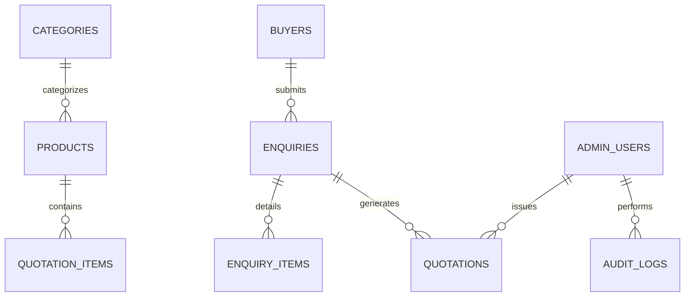

# Database Architecture & Row-Level Security (RLS)

The database schema is defined in `database/migrations/001_initial_schema.sql` and deployed on PostgreSQL with Supabase extensions.

---

## 1. Relational Schema & Tables

### Table Dictionary

| Table | Purpose | Security Context |
|---|---|---|
| `categories` | Spice commodity groupings (Turmeric, Pepper, Chilli, Cardamom, etc.) | Public Read / Admin Write |
| `products` | Export commodities, GI tags, specifications, grades, packaging options | Public Read / Admin Write |
| `enquiries` | International buyer RFQ submissions, status workflow, destination ports | Admin Only Read/Write (Public Insert via API) |
| `enquiry_items` | Individual spice line items within an inquiry | Admin Only Read/Write |
| `quotations` | Commercial proforma quotations with Incoterms, freight, and terms | Admin Only Read/Write |
| `quotation_items` | Line items with unit pricing (FOB/CIF) and volume | Admin Only Read/Write |
| `suppliers` | Direct grower co-operatives, estate owners, and spice processing plants | **Strictly Internal / Admin Only** |
| `buyers` | CRM-lite records of international importers, brokers, and retail chains | Admin Only Read/Write |
| `content_blocks` | Site builder customizable sections, revision history, and drafts | Public Read (Published) / Admin Write |
| `settings` | Global company identity, Spices Board / APEDA certifications, contact numbers | Public Read (Filtered) / Admin Write |
| `media` | Uploaded images, certificates, laboratory assay PDFs | Public Read / Admin Write |
| `admin_users` | Authorized control room personnel and role designations | **Owner Only Read/Write** |
| `audit_logs` | Immutable audit trail of operational changes and security events | **Owner Only Read (Append-Only)** |
| `seo_metadata` | Per-page titles, descriptions, canonical URLs, and indexing flags | Public Read / Admin Write |
| `navigation_items`| Header navbar links and footer link columns | Public Read / Admin Write |
| `templates` | Email and WhatsApp notification blueprints with template variables | Admin Only Read/Write |

---

## 2. Row-Level Security (RLS) Policies

All tables enforce Postgres Row-Level Security (`ALTER TABLE ... ENABLE ROW LEVEL SECURITY`).

### Public vs. Admin Access Rules

1. **Public Read-Only Tables**:
   - `categories`: Allowed where `is_published = true`.
   - `products`: Allowed where `status = 'published'`.
   - `content_blocks`: Allowed where `status = 'published'`.
   - `seo_metadata`, `navigation_items`: Publicly readable.

2. **Public Insert-Only (Protected Endpoint)**:
   - `enquiries` & `enquiry_items`: Public cannot query past inquiries; submissions flow through Express validation endpoint `/api/enquiries` using Supabase service role privileges.

3. **Confidential Internal Tables**:
   - `suppliers`: Zero public policies. Only authenticated admin roles (`Owner`, `Editor`, `Sales`) with verified JWTs may access. Supplier contacts are never exposed on public storefront APIs.
   - `quotations`, `buyers`, `audit_logs`, `admin_users`: Zero public access.

---

## 3. Database Indexes

- `products(slug)`: Unique B-tree index for instant slug lookup.
- `products(category_id, status)`: Composite index for category filtering.
- `enquiries(status, created_at DESC)`: Composite index for dashboard and inquiry inbox sorting.
- `quotations(reference_number)`: Unique index for proforma lookup.
- `audit_logs(created_at DESC)`: Index for high-speed compliance review.
